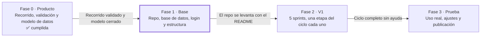

# IAmigo — Hoja de ruta hacia la V1

Oct 15, 2026 · @Pablo

IAmigo llega a su V1 en cuatro fases. Cada fase termina en un punto de control: no se pasa a la siguiente hasta cumplirlo.

## Mapa

Las fases van en orden y no tienen fechas todavía: la duración de los sprints se define con el equipo al armar el backlog.

## Fase 0 · Producto

Define qué se construye antes de escribir código. Se trabaja en el chat del Proyecto IAmigo.

- [x] Escribir el recorrido del usuario de la V1
- [x] Cerrar las preguntas abiertas del recorrido
- [x] Escribir el guion de validación (tarea a pedir, qué observar, preguntas finales)
- [x] Dibujar bocetos simples de las cinco pantallas: Bandeja, Desmenuzar, Hoy, Modo foco y Cierre
- [x] Armar el borrador del modelo de datos (provisional)
- [x] Hacer las sesiones con personas con TDAH (primera ronda: 3 personas)
- [x] Ajustar el recorrido y los bocetos con lo aprendido
- [x] Repetir la prueba de Desmenuzar con las mismas personas
- [x] Cerrar el modelo de datos
- [x] Escribir el backlog de la V1: una épica por etapa, con historias de usuario

**Punto de control:** el recorrido está validado con personas reales y el modelo de datos está cerrado. ✅ Cumplido el 27 de octubre de 2026.

## Fase 1 · Base técnica

Deja listo el terreno donde se construye la V1. Desde aquí conviene trabajar en Claude Code, directamente sobre el repositorio.

- [x] Crear el repositorio nuevo de IAmigo
- [x] Copiar la base del backend de IAmigo-Final: arquitectura en capas, autenticación JWT y servicio de IA
- [x] Quitar lo específico de TPAC y la versión de consola
- [ ] Crear la base de datos con el modelo cerrado en la Fase 0
- [x] Cambiar el login de nombre a correo
- [ ] Configurar `.env`, `.gitignore`, CORS y los tests que ya existen
- [ ] Crear la estructura del front en JavaScript puro, organizada en módulos y pensada para celular
- [ ] Escribir el README con cómo levantar el proyecto

**Punto de control:** una persona del equipo clona el repo, lo levanta siguiendo el README, se registra e inicia sesión.

## Fase 2 · Construcción de la V1

Cada sprint entrega una etapa del ciclo funcionando de punta a punta: endpoint, pantalla y prueba. Al final de cada uno se hace una demo.

**Sprint 1 · Capturar**

- [ ] Pantalla de inicio con el campo "¿Qué tienes en la cabeza?"
- [ ] Guardar en la Bandeja, una tarea por línea
- [ ] Listar la Bandeja

**Sprint 2 · Desmenuzar**

- [ ] Ajustar el prompt de la IA para que estime minutos por paso
- [ ] Pantalla de pasos: editar, borrar, agregar y reordenar
- [ ] Escribir pasos a mano si la IA falla

**Sprint 3 · Planear hoy**

- [ ] Pantalla Hoy con Ahora y Después, con límite de tareas configurable (3 por defecto)
- [ ] Elegir y ordenar tareas desde la Bandeja
- [ ] Mostrar el tiempo total estimado del día

**Sprint 4 · Hacer (modo foco)**

- [ ] Pantalla de un paso con temporizador circular
- [ ] Botones Hecho, +5 minutos, Me atasqué y Pausar
- [ ] Celebración breve por paso y tarea concluida al terminar el último
- [ ] Retomar donde quedó al volver a la app

**Sprint 5 · Cerrar el día y primer uso**

- [ ] Resumen del día y lo pendiente con "Hacerla mañana" o "Guardarla sin fecha"
- [ ] Resumen al abrir la app si el día anterior no se cerró
- [ ] Registro, bienvenida y primera tarea guiada

**Punto de control:** una persona nueva completa el ciclo entero con una tarea real, sin ayuda.

## Fase 3 · Prueba real y lanzamiento

Comprueba que la app funciona en la vida diaria de las personas, no solo en una demo.

- [ ] Volver a las 3 a 5 personas de la validación y pedirles que usen la app durante varios días
- [ ] Recoger lo que funcionó, lo que confundió y lo que dejaron de usar
- [ ] Corregir los problemas más graves
- [ ] Revisar los siete principios de diseño pantalla por pantalla
- [ ] Proteger las rutas de tareas y pasos para que nadie vea datos ajenos
- [ ] Publicar la app en un hosting accesible desde el celular

**Punto de control:** se cumple el criterio de éxito del recorrido con personas que no participaron en el desarrollo.

## Después de la V1

La V2 se prioriza con lo que digan los usuarios en la Fase 3. Los candidatos ya identificados son rutinas recurrentes, notificaciones (convirtiendo la web en PWA), check-in de energía, rachas sin castigo, música durante el modo foco y editar pasos desde más lugares.
