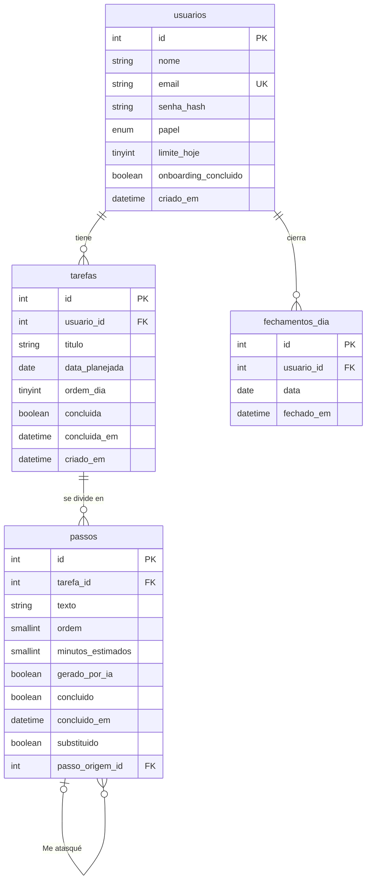

# IAmigo — Modelo de datos (V1)

Oct 27, 2026 · @Pablo · Modelo cerrado

La V1 necesita cuatro tablas: usuarios, tareas, pasos y cierres del día. Este modelo sale directamente del recorrido validado y mantiene los nombres en portugués de la base de IAmigo.

## Mapa de las tablas



Cada usuario tiene muchas tareas y muchos cierres del día; cada tarea tiene muchos pasos. Borrar un usuario o una tarea borra en cascada todo lo que cuelga de ellos.

## Tablas

### usuarios

| Columna | Tipo | Regla | Para qué |
| --- | --- | --- | --- |
| `id` | INT | clave primaria, autoincremental | Identificar a la persona |
| `nome` | VARCHAR(100) | obligatorio | Saludo en la Bandeja |
| `email` | VARCHAR(255) | obligatorio, único | Login |
| `senha_hash` | VARCHAR(255) | obligatorio | Contraseña con hash, como en IAmigo |
| `papel` | ENUM('usuario', 'admin') | por defecto `usuario` | Permisos de gestión de cuentas |
| `limite_hoje` | TINYINT | por defecto 3, entre 1 y 5 | Cuántas tareas caben en Hoy |
| `onboarding_concluido` | BOOLEAN | por defecto falso | Mostrar la primera tarea guiada una sola vez |
| `criado_em` | DATETIME | por defecto ahora | Fecha de registro |

### tarefas

| Columna | Tipo | Regla | Para qué |
| --- | --- | --- | --- |
| `id` | INT | clave primaria, autoincremental | Identificar la tarea |
| `usuario_id` | INT | obligatorio, se borra con el usuario | Dueña de la tarea |
| `titulo` | VARCHAR(200) | obligatorio | Lo que la persona anotó |
| `data_planejada` | DATE | opcional | Vacía: está en la Bandeja. Con fecha: está en Hoy de ese día |
| `ordem_dia` | TINYINT | opcional | Posición en Hoy; la 1 es Ahora |
| `concluida` | BOOLEAN | por defecto falso | Tarea terminada |
| `concluida_em` | DATETIME | opcional | Para el resumen del día |
| `criado_em` | DATETIME | por defecto ahora | Orden de la Bandeja |

### passos

| Columna | Tipo | Regla | Para qué |
| --- | --- | --- | --- |
| `id` | INT | clave primaria, autoincremental | Identificar el paso |
| `tarefa_id` | INT | obligatorio, se borra con la tarea | Tarea a la que pertenece |
| `texto` | VARCHAR(255) | obligatorio | Lo que se muestra en el modo foco |
| `ordem` | SMALLINT | obligatorio | Orden dentro de la tarea |
| `minutos_estimados` | SMALLINT | por defecto 10 | Duración del temporizador |
| `gerado_por_ia` | BOOLEAN | por defecto falso | Saber si lo sugirió IAmigo o la persona |
| `concluido` | BOOLEAN | por defecto falso | Paso hecho |
| `concluido_em` | DATETIME | opcional | Para el resumen del día |
| `substituido` | BOOLEAN | por defecto falso | Paso trabado que se dividió con "Me atasqué"; no se muestra en el modo foco |
| `passo_origem_id` | INT | opcional, apunta a otro paso | En los pasos nuevos de "Me atasqué", cuál era el paso original |

### fechamentos_dia

| Columna | Tipo | Regla | Para qué |
| --- | --- | --- | --- |
| `id` | INT | clave primaria, autoincremental | Identificar el cierre |
| `usuario_id` | INT | obligatorio, se borra con el usuario | Quién cerró el día |
| `data` | DATE | obligatorio, único por usuario | Qué día se cerró |
| `fechado_em` | DATETIME | por defecto ahora | Cuándo se cerró |

## Decisiones de diseño

Cada decisión busca guardar lo mínimo y derivar el resto, para que no haya datos que se contradigan.

- **Sin campo de estado en las tareas.** Que una tarea esté en la Bandeja o en Hoy depende solo de `data_planejada`. "Hacerla mañana" pone la fecha de mañana; "Guardarla sin fecha" la deja vacía. Una tarea con fecha pasada y sin concluir se muestra en la Bandeja sin que nadie la toque, como pide el recorrido.
- **El temporizador y la pausa no se guardan.** Viven en el front durante la V1.
- **"Retomar donde quedó" se deriva.** Alcanza con buscar el primer paso sin concluir de la tarea en Ahora.
- **"Me atasqué" guarda el paso original.** El paso trabado no se borra: se marca como `substituido` y deja de mostrarse, y los 2 o 3 pasos nuevos apuntan a él con `passo_origem_id`. El modo foco sigue leyendo una lista plana, y queda registro de en qué pasos se traba la gente, útil para mejorar el prompt y, más adelante, para deshacer una división.
- **Los cierres del día se registran.** `fechamentos_dia` permite mostrar el resumen pendiente al abrir la app al día siguiente y, en la V2, calcular rachas sin agregar tablas.
- **Las cantidades del resumen no se guardan.** Se cuentan desde `concluido_em` y `concluida_em` de la fecha.

## Qué lee y escribe cada etapa

Esta tabla es la base para definir los endpoints de cada sprint.

| Etapa | Lee | Escribe |
| --- | --- | --- |
| Capturar | Tareas sin fecha o con fecha pasada, sin concluir | Tarea nueva con `data_planejada` vacía |
| Desmenuzar | La tarea y sus pasos | Pasos nuevos, con `gerado_por_ia` y `minutos_estimados` |
| Planear hoy | Tareas de la Bandeja y `limite_hoje` del usuario | `data_planejada` = hoy y `ordem_dia` |
| Hacer | Pasos no sustituidos de la tarea en Ahora, ordenados | `concluido` del paso; al terminar el último, `concluida` de la tarea |
| Me atasqué | El paso trabado | Marca ese paso como `substituido` y crea 2 o 3 en su lugar con `passo_origem_id`, reordenando |
| Cerrar el día | Pasos y tareas concluidos en la fecha | `data_planejada` = mañana o vacía en lo pendiente, y una fila en `fechamentos_dia` |
| Primer uso | `onboarding_concluido` | `onboarding_concluido` = verdadero al terminar la tarea guiada |

## Script SQL

Script para MySQL, listo para la Fase 1 una vez que el modelo se cierre.

```sql
CREATE TABLE usuarios (
  id INT AUTO_INCREMENT PRIMARY KEY,
  nome VARCHAR(100) NOT NULL,
  email VARCHAR(255) NOT NULL UNIQUE,
  senha_hash VARCHAR(255) NOT NULL,
  papel ENUM('usuario', 'admin') NOT NULL DEFAULT 'usuario',
  limite_hoje TINYINT UNSIGNED NOT NULL DEFAULT 3,
  onboarding_concluido BOOLEAN NOT NULL DEFAULT FALSE,
  criado_em DATETIME NOT NULL DEFAULT CURRENT_TIMESTAMP,
  CONSTRAINT chk_limite_hoje CHECK (limite_hoje BETWEEN 1 AND 5)
);

CREATE TABLE tarefas (
  id INT AUTO_INCREMENT PRIMARY KEY,
  usuario_id INT NOT NULL,
  titulo VARCHAR(200) NOT NULL,
  data_planejada DATE NULL,
  ordem_dia TINYINT UNSIGNED NULL,
  concluida BOOLEAN NOT NULL DEFAULT FALSE,
  concluida_em DATETIME NULL,
  criado_em DATETIME NOT NULL DEFAULT CURRENT_TIMESTAMP,
  FOREIGN KEY (usuario_id) REFERENCES usuarios(id) ON DELETE CASCADE,
  INDEX idx_tarefas_usuario_data (usuario_id, data_planejada)
);

CREATE TABLE passos (
  id INT AUTO_INCREMENT PRIMARY KEY,
  tarefa_id INT NOT NULL,
  texto VARCHAR(255) NOT NULL,
  ordem SMALLINT UNSIGNED NOT NULL,
  minutos_estimados SMALLINT UNSIGNED NOT NULL DEFAULT 10,
  gerado_por_ia BOOLEAN NOT NULL DEFAULT FALSE,
  concluido BOOLEAN NOT NULL DEFAULT FALSE,
  concluido_em DATETIME NULL,
  substituido BOOLEAN NOT NULL DEFAULT FALSE,
  passo_origem_id INT NULL,
  FOREIGN KEY (tarefa_id) REFERENCES tarefas(id) ON DELETE CASCADE,
  FOREIGN KEY (passo_origem_id) REFERENCES passos(id) ON DELETE SET NULL,
  INDEX idx_passos_tarefa_ordem (tarefa_id, ordem)
);

CREATE TABLE fechamentos_dia (
  id INT AUTO_INCREMENT PRIMARY KEY,
  usuario_id INT NOT NULL,
  data DATE NOT NULL,
  fechado_em DATETIME NOT NULL DEFAULT CURRENT_TIMESTAMP,
  FOREIGN KEY (usuario_id) REFERENCES usuarios(id) ON DELETE CASCADE,
  UNIQUE KEY uq_fechamento_usuario_data (usuario_id, data)
);
```

## Para revisar en equipo

Con estas preguntas respondidas, el modelo se puede dar por cerrado.

- [x] ¿Mantenemos los nombres en portugués, como en IAmigo? Sí.
- [x] ¿Qué día es "hoy" para la app? El de la hora local de la persona: el front envía su fecha local en cada pedido.
- [x] ¿`limite_hoje` tiene un mínimo y un máximo? Mínimo 1 y máximo 5, con 3 por defecto.
- [x] ¿"Me atasqué" reemplaza el paso, o conviene guardar el paso original? Se guarda, marcado como `substituido`.
- [x] ¿Falta algún dato que alguna pantalla de los bocetos necesite? Por el momento no.
