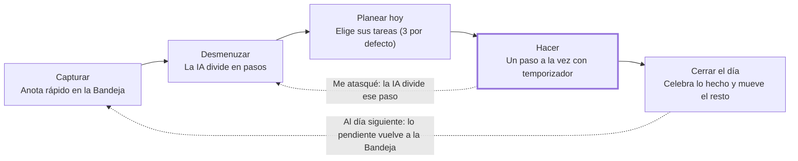

# IAmigo — Recorrido del usuario (V1)

Oct 15, 2026 · @Pablo

## Objetivo

La V1 de IAmigo lleva a un adulto con TDAH de "tengo mil cosas en la cabeza" a "terminé lo importante de hoy" con un ciclo diario de cinco etapas: capturar, desmenuzar, planear hoy, hacer y cerrar el día.

Este documento describe ese recorrido pantalla por pantalla. Es la base para definir el modelo de datos, los endpoints y el backlog de los sprints.

Criterio de éxito de la V1: una persona nueva completa el ciclo entero en su primer día, sin ayuda y con una tarea real.

## Persona

Persona provisional, a validar con usuarios reales: **Camila, 24 años**, estudia en la universidad y trabaja medio tiempo. Tiene diagnóstico de TDAH y usa el celular todo el día; la PC solo para estudiar.

Lo que le cuesta, y lo que IAmigo debe resolver:

- **Empezar:** una tarea como "hacer el trabajo final" parece tan grande que la posterga.
- **Percibir el tiempo:** no nota cuánto pasó ni cuánto le llevará algo.
- **Decidir:** con una lista larga, no sabe por dónde empezar y no empieza.
- **Recordar:** las ideas aparecen en cualquier momento y se pierden si no las anota rápido.
- **Sostener el hábito:** ya abandonó otras apps porque las tareas atrasadas en rojo la hacían sentir culpable.

## Principios de diseño

Cada pantalla de la V1 se revisa contra estas siete reglas antes de darla por terminada.

1. **Una cosa a la vez.** Cada pantalla tiene una sola acción principal, con un botón claramente más grande que el resto.
2. **Capturar en segundos.** Anotar una idea nunca exige más de un campo y un toque.
3. **El tiempo se ve.** Todo lo que tiene duración muestra un temporizador o una barra, no solo números.
4. **Sin culpa.** No hay rojo, ni "atrasado", ni contadores de tareas pendientes. Lo que no se hizo se mueve, no se castiga.
5. **Recompensa inmediata.** Cada paso terminado recibe una respuesta visual al instante.
6. **Lenguaje corto y amable.** Frases de menos de diez palabras, en segunda persona, sin jerga técnica.
7. **La IA sugiere, la persona decide.** Todo lo que genera la IA se puede editar, borrar o ignorar.

## Mapa del ciclo

El ciclo avanza de izquierda a derecha cada día. Hay dos retornos: "Me atasqué" vuelve a desmenuzar el paso, y lo pendiente vuelve a la Bandeja al día siguiente.

## Recorrido etapa por etapa

Cada etapa indica qué ve la persona, qué hace, cómo responde la app y qué datos necesita el backend.

### 1. Capturar

- **Ve:** en la pantalla de inicio, un campo grande: "¿Qué tienes en la cabeza?".
- **Hace:** escribe y presiona Enter. Puede anotar varias cosas seguidas, una por línea.
- **La app:** guarda cada línea como tarea en la **Bandeja**, sin fecha ni prioridad, y limpia el campo para la siguiente. Si la persona toca "+" con el campo vacío, el cursor va al campo.
- **Datos:** tarea con título, sin fecha planificada (`data_planejada` vacía) y fecha de creación.

### 2. Desmenuzar

- **Ve:** al tocar una tarea de la Bandeja, su detalle. Si todavía no tiene pasos, el botón "Que IAmigo lo divida" es lo primero y lo más grande de la pantalla, con la frase "IAmigo te sugiere los pasos y tú los ajustas" y, debajo, la opción "Prefiero escribirlos yo".
- **Hace:** toca el botón. Revisa los pasos: puede editarlos, borrarlos, agregar otros y cambiar el orden. Termina con "Listo".
- **La app:** la IA devuelve entre 3 y 7 pasos cortos, cada uno con minutos estimados, y muestra el total ("unos 45 minutos").
- **Datos:** paso con texto, minutos estimados, orden y concluido. Se reutiliza la generación de pasos de IAmigo, con el prompt ajustado para estimar minutos.
- Una tarea pequeña puede saltarse esta etapa: en modo foco se trata como un único paso.

### 3. Planear hoy

- **Ve:** la pantalla **Hoy**, con espacio para 3 tareas por defecto, la opción "Cambiar límite" y la Bandeja debajo.
- **Hace:** elige tareas hasta su límite de dos formas: con el botón "+ Hoy" de cada tarea en la Bandeja, o con "Elegir tareas para hoy", que abre la Bandeja como lista para marcar, con el contador del límite a la vista. Después las ordena.
- **La app:** la primera queda en **Ahora** y las otras en **Después**. Muestra el tiempo total estimado del día.
- **Datos:** fecha de planificación y orden dentro del día en la tarea; en el usuario, el límite de tareas por día (3 por defecto).

### 4. Hacer (modo foco)

- **Ve:** al tocar "Empezar", una pantalla con un solo paso en letra grande, bajo la etiqueta "Tu paso ahora", y un temporizador circular que se vacía según los minutos estimados.
- **Hace:** usa uno de cuatro botones: **Hecho** (el principal), **+5 minutos**, **Me atasqué** o **Pausar**.
- **La app:** con "Hecho", muestra una celebración breve y pasa al siguiente paso. Al terminar el último, marca la tarea como concluida y vuelve a Hoy con la siguiente tarea en Ahora.
- **Datos:** marcar el paso como concluido. El temporizador vive solo en el front en la V1.

### 5. Cerrar el día

- **Ve:** al completar las tareas de Hoy, o al tocar "Terminar el día", un resumen: "Hoy completaste 9 pasos y 2 tareas".
- **Hace:** para cada tarea sin terminar, elige **Hacerla mañana** o **Guardarla sin fecha** (vuelve a la Bandeja).
- **La app:** nunca muestra lo que faltó como fracaso; el mensaje destaca solo lo logrado.
- **Datos:** consulta de pasos y tareas concluidos en la fecha.

## Primer uso

El primer uso enseña el ciclo haciéndolo con una tarea real, no con un tutorial largo.

1. **Registro:** nombre, correo y contraseña en una sola pantalla. Se reutiliza el login con JWT de IAmigo.
2. **Bienvenida:** una pantalla con una frase y las cinco etapas en íconos: "Anota, divide, elige, hazlo, celebra".
3. **Primera tarea guiada:** la app pide "Escribe una cosa que tengas pendiente" y acompaña a la persona por desmenuzar, ponerla en Hoy y empezar el primer paso.
4. **Listo:** al terminar ese primer paso, la app explica en una frase que así funciona cada día.

## Situaciones especiales

Estos casos son frecuentes con TDAH, así que la V1 los resuelve desde el inicio.

| Situación | Qué hace la app |
| --- | --- |
| Se atasca en un paso | Con "Me atasqué", la IA divide ese paso en 2 o 3 más pequeños y la persona sigue desde el primero. |
| Cierra la app a mitad de una tarea | Al volver, muestra "¿Seguimos donde quedaste?" con el paso pendiente. |
| Abre la app sin haber planeado el día | Hoy no aparece vacío: muestra "Elige una cosa de tu Bandeja para empezar". |
| El temporizador llega a cero | No hay alarma ni rojo: el círculo queda lleno y ofrece "Hecho" o "+5 minutos". |
| La IA falla o no hay conexión | La persona puede escribir los pasos a mano; la app avisa en una frase, sin bloquear. |
| Una tarea no tiene pasos | El modo foco la muestra como un único paso. |
| Pasa un día sin abrir la app | Las tareas de Hoy vuelven a la Bandeja en silencio, sin mensajes de reproche. |

## Fuera de la V1

Estas funciones son valiosas, pero entran recién cuando el ciclo diario funcione bien con usuarios reales.

- **V2:** rutinas recurrentes, notificaciones y recordatorios (requieren convertir la web en PWA), check-in de energía que adapta el plan, rachas sin castigo y música para concentrarse durante el modo foco.
- **Más adelante:** vista semanal o calendario, entrada por voz, estadísticas, personalización con colores e íconos, widgets y app nativa.
- **No previsto:** panel de administración más allá de la gestión de cuentas que ya existe en IAmigo.

## Cambios tras la validación

Primera ronda con 3 personas, notas finales 4, 3 y 3. En la segunda ronda, las mismas personas señalaron que "Dividir en pasos" no dejaba claro que lo hace la app, y que la Bandeja no permitía elegir tareas para Hoy. Se renombró el botón y se agregaron "+ Hoy" y la pantalla "Elegir para hoy".

- **Desmenuzar:** ninguna encontró "Dividir en pasos" porque el boceto no tenía ese botón. Se agregó la pantalla de tarea sin pasos y se volvió a probar en la segunda ronda: se entendió.
- **Límite de Hoy:** las 3 pidieron más flexibilidad. Pasa a ser configurable, 3 por defecto.
- **Ajustes de claridad:** etiqueta "Tu paso ahora" en el modo foco, botones "Hacerla mañana" y "Guardarla sin fecha" en el cierre, y "+" que lleva al campo en la Bandeja.
- **Para la V2:** música durante el modo foco y editar pasos desde más lugares.

## Preguntas abiertas

Estas decisiones conviene cerrarlas antes de definir el modelo de datos.

- [x] ¿El límite de Hoy es 3 tareas fijas o configurable? (configurable entre 1 y 5, 3 por defecto: lo pidieron las 3 personas de la validación)
- [x] ¿Login con correo (recomendado) o con nombre, como en IAmigo? (correo)
- [x] ¿Front en JavaScript puro o con un framework? Modo foco y Hoy tienen bastante interacción. (javascript para la v1)
- [x] ¿Se diseña primero para celular o para escritorio? (celular)
- [x] ¿Proveedor de IA: Gemini, como hoy, u otro? (gemini)
- [x] ¿Cuántos minutos asume un paso si la IA no estima? (10, más el botón +5 minutos)
- [x] ¿El cierre del día lo dispara la persona, una hora fija o la primera apertura del día siguiente? (lo dispara la persona; si no lo hizo, el resumen aparece al abrir la app al día siguiente.)
- [x] ¿Con qué personas con TDAH se va a validar este recorrido, y cuándo? (3 a 5 personas, antes de cerrar el modelo de datos, mostrando el recorrido con bocetos simples, porque es el momento en que cambiar algo todavía no cuesta código.)
